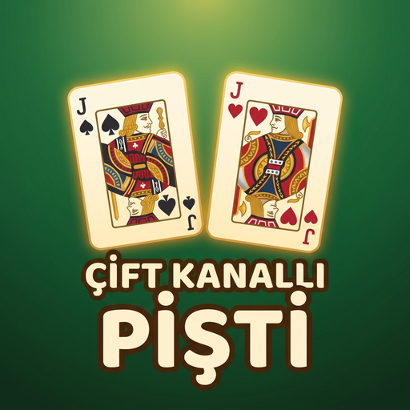

<div align="center">



# Çift Kanallı Pişti

**Bildiğin pişti, ama iki kanallı.**
Kahvehane masasından telefonuna: kendi kurallarımızla oynanan pişti.

<br>

[](#iphone-kurulum)<br>
**[📖 Nasıl kurulur? (oyunun linki burada)](#iphone-kurulum)**

<sub>Ücretsiz · Reklamsız · Android: Google Play'de kapalı testte, yakında herkese açık · iPhone ve bilgisayarda tarayıcıdan</sub>

<br>

> 📌 **Kurmadan önce lütfen aşağıdaki [Nasıl Kurulur?](#nasil-kurulur) bölümünü okuyun.**
> Özellikle **iPhone**'da oyunu uygulama gibi kullanmak için birkaç kolay adım var.

</div>

---

## 🃏 Oyun Nedir?

**Çift Kanallı Pişti**, normal piştiden türetilmiş bir kart oyunu. Kurallar normal pişti gibidir ama masada fazladan iki **pişti kanalı** vardır. Kanallar oyuna yeni pişti fırsatları ve biraz da tuzak ekler.

- 🟢 Kahvehane masası görünümü: yeşil çuha, ahşap masa
- 🤖 Bilgisayara karşı oyna: **2, 3 veya 4 kişilik**, 4 kişide **eşli** ya da tekli
- 🏆 1, 3 veya 5 oyunluk maçlar
- 📵 İnternet gerekmez, reklam yok
- 🔊 Sesler ve titreşim: pişti, kanal piştisi ve **vale piştisi için özel ses**
- ⚙️ Ayarlar: adın, masa rengi, kart arkası rengi, ses, titreşim, oyun hızı
- 📊 İstatistikler: kazandığın maçlar, piştiler, vale piştileri, galibiyet serisi
- 📖 Oyunun içinde "Nasıl Oynanır?" rehberi

---

<a id="nasil-kurulur"></a>

## 📲 Nasıl Kurulur?

### 🤖 Android'de

Oyun **Google Play**'e geliyor. Şu an kapalı testte: test listesine eklenen kişiler Play Store'dan kurabilir. Herkese açılınca linki buraya eklenecek. O zamana kadar Android telefonda da aşağıdaki web adresinden oynayabilirsin.

<a id="iphone-kurulum"></a>

### 🍎 iPhone'da

İndirilecek bir dosya yok. Oyun Safari'de açılır, ana ekrana eklenince uygulama gibi çalışır:

1. iPhone'dan **Safari** ile şu linke dokun: **[🃏 Oyunu aç: furkanrdmm.github.io/cift-kanalli-pisti](https://furkanrdmm.github.io/cift-kanalli-pisti/)** *(Chrome değil, Safari olmalı)*
2. Alttaki **Paylaş** düğmesine (kare içinde yukarı ok ⬆︎) dokun.
3. Aşağı kaydırıp **"Ana Ekrana Ekle"** de, sonra **Ekle**.
4. Ana ekranda oyunun simgesi çıkar. Oradan açınca uygulama gibi tam ekran açılır.

> Oyun kendiliğinden güncellenir, bir şey indirmene gerek yok. iPhone tarayıcıda titreşime izin vermediği için titreşim çalışmaz. Ses gelmiyorsa telefonun yanındaki sessiz düğmesini kontrol et.

### 💻 Bilgisayarda

Aynı adresi ([furkanrdmm.github.io/cift-kanalli-pisti](https://furkanrdmm.github.io/cift-kanalli-pisti/)) herhangi bir tarayıcıda açman yeterli.

---

## 📜 Kurallar

### Masa
```
  PİŞTİ KANALLARI            YER
  ┌────┐  ┌────┐           ┌────┐
  │ 7♥ │  │ Q♠ │           │ 4♣ │  ← açık
  └────┘  └────┘           └────┘  ← altında 1 kapalı kart
```
- Solda **2 açık kart** var: bunlar **pişti kanalları**.
- Sağda **1 kapalı + 1 açık** kart var: burası normal pişti oynanan **yer**.
- Yere açılan 4 kartın 3'ü aynı olamaz.
- Her oyuncuya **4'er kart** dağıtılır. Eller bitince deste bitene kadar yeniden dağıtılır.

### Pişti Kanalları
- Kanala **sadece pişti yapılır**: kanaldaki kartın aynısını atarsın (7'ye 7, kıza kız).
- Kanala başka kart atılamaz. Vale de kanaldaki kartı almaz, sadece valeyle pişti olur.
- Elindeki kart kanaldaki kartla aynıysa, o kartı **sadece kanala pişti için** oynayabilirsin, yere atamazsın (kanalda 2 varsa elindeki 2 yere gitmez). O kartı oynamak zorunda değilsin, başka kartını oynayabilirsin.
- Bir kanala pişti yapılınca o kanal **boş kalır**. Diğerine de pişti yapılana kadar oraya kart atılmaz.

### Kanallar Bitince: İki Yer
- İki kanala da pişti yapılınca kanalların yeri **ikinci bir normal yer** olur.
- **Sıradaki oyuncu bu yeni yere kart atmak zorundadır**, başka yere oynayamaz.
- Bundan sonra iki yerden istediğine oynarsın. İkisinde de normal pişti kuralları geçerlidir.
- Yerlerden biri alınıp **boş kalırsa**, sıradaki oyuncu oraya kart atmak zorundadır. Yer boş kalamaz.

### Yer
- Normal pişti gibi: en üstteki kartın aynısını atarsan ya da **vale** atarsan yerdeki bütün kartları alırsın.
- Yerde **tek kart** varken aynısını atarsan: **PİŞTİ!**
- Yer alınıp **boş kalırsa**, sıradaki oyuncu **mecburen yere kart atar**. O el kanala pişti yapamaz.

### 3 ve 4 Kişilik Oyun
- Kurallar aynı, her elde herkese 4'er kart dağıtılır (2 kişide 6 el, 3 kişide 4 el, 4 kişide 3 el).
- **4 kişi eşli:** karşılıklı oturanlar takımdır; takım arkadaşının kartları ve piştileri ortak sayılır.
- **Tekli:** herkes kendi puanını toplar.
- Sıra saat yönünün tersine döner: senden sonra sağındaki oyuncu oynar.

### Puanlar
| | Puan |
|---|:---:|
| Pişti (kanalda veya yerde) | **10** |
| Vale ile vale piştisi | **20** |
| En çok kart toplayan | **3** |
| Karo 10 (♦10) | **3** |
| Sinek 2 (♣2) | **2** |
| Her as ve her vale | **1** |

- Oyun sonunda yerlerde kalan bütün kartlar **en son kart alan** oyuncuya gider.
- Deste bitince en çok puanı olan oyunu kazanır. Maçı, seçilen sayıda (1, 3 veya 5) oyunu ilk alan kazanır.

---

<div align="center">

**[🃏 Tarayıcıda Oyna](https://furkanrdmm.github.io/cift-kanalli-pisti/)**

<sub>Geliştirme notları için: [GELISTIRME.md](GELISTIRME.md)</sub>

</div>
